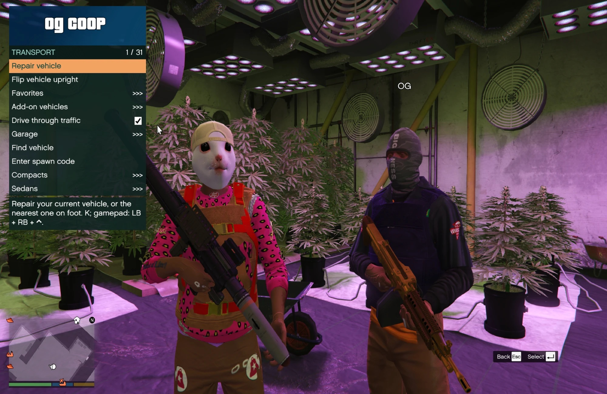
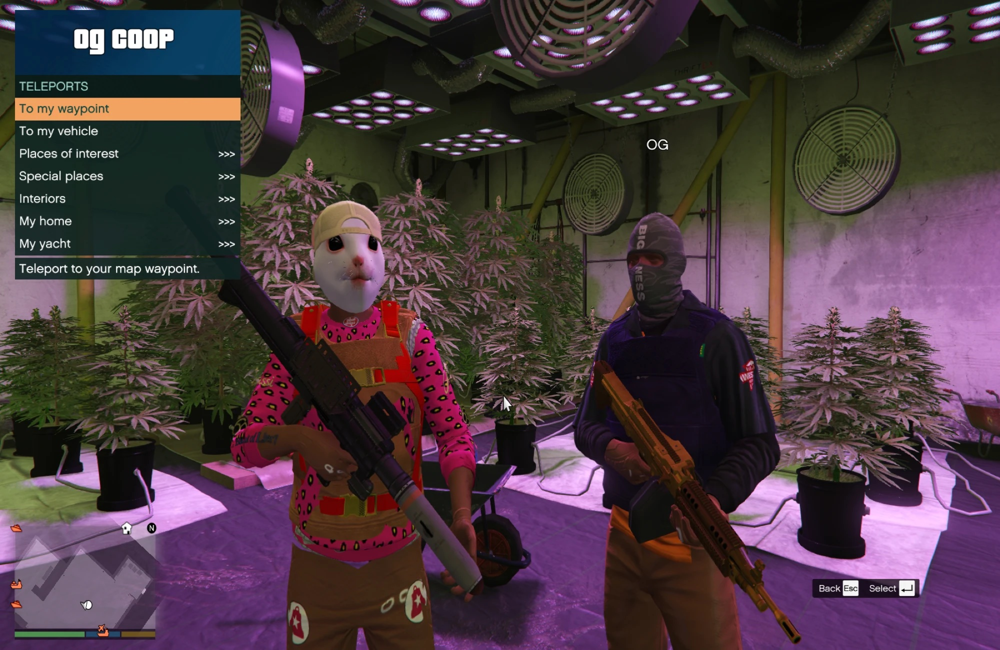
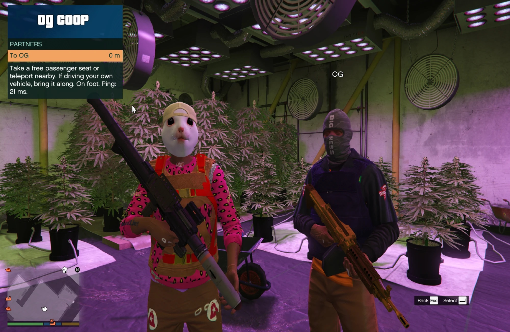
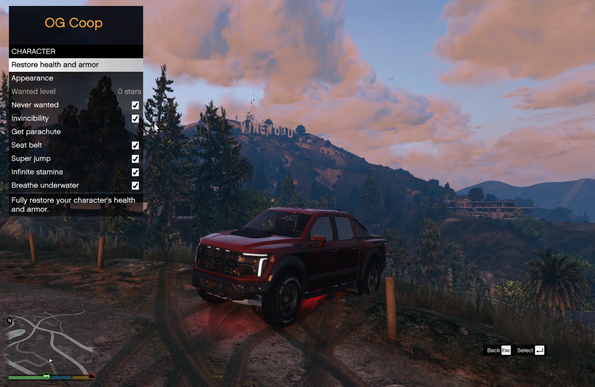
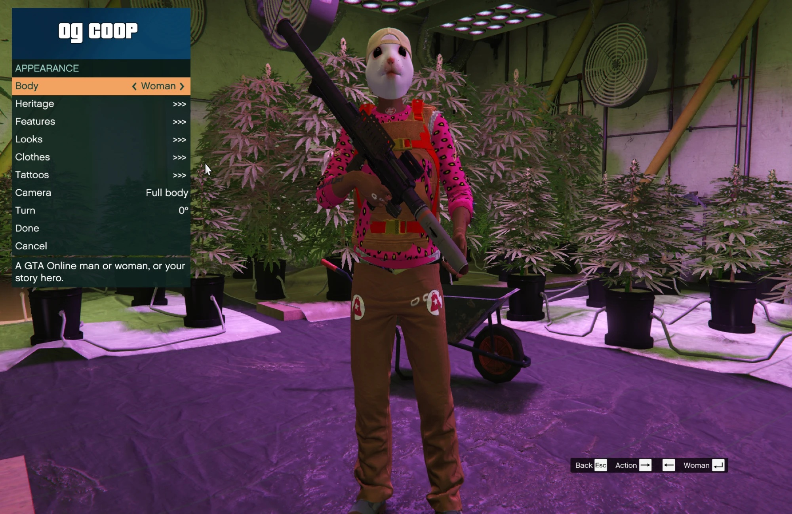
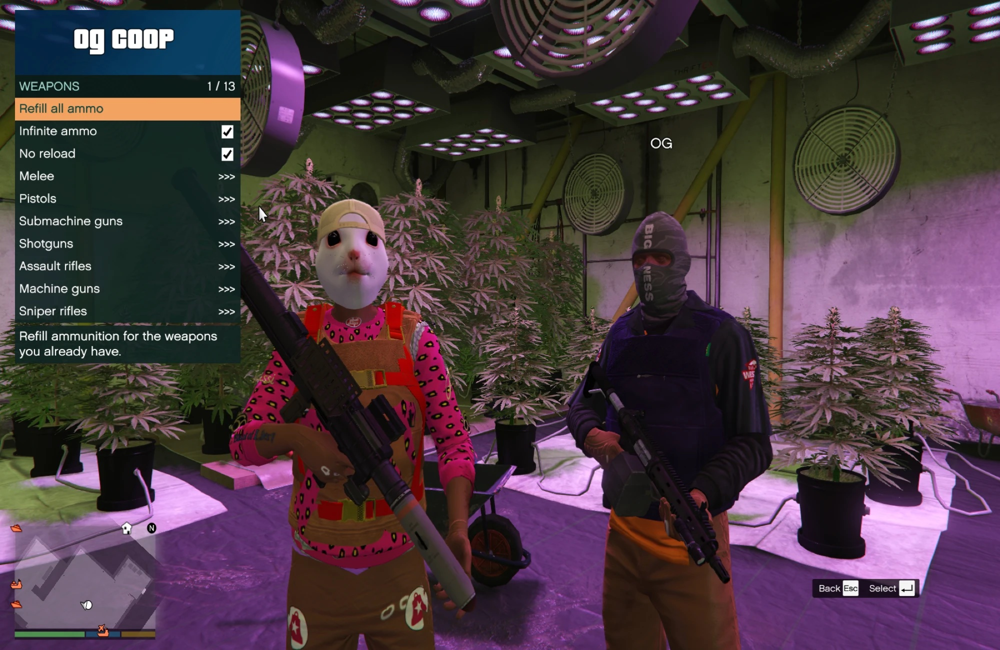
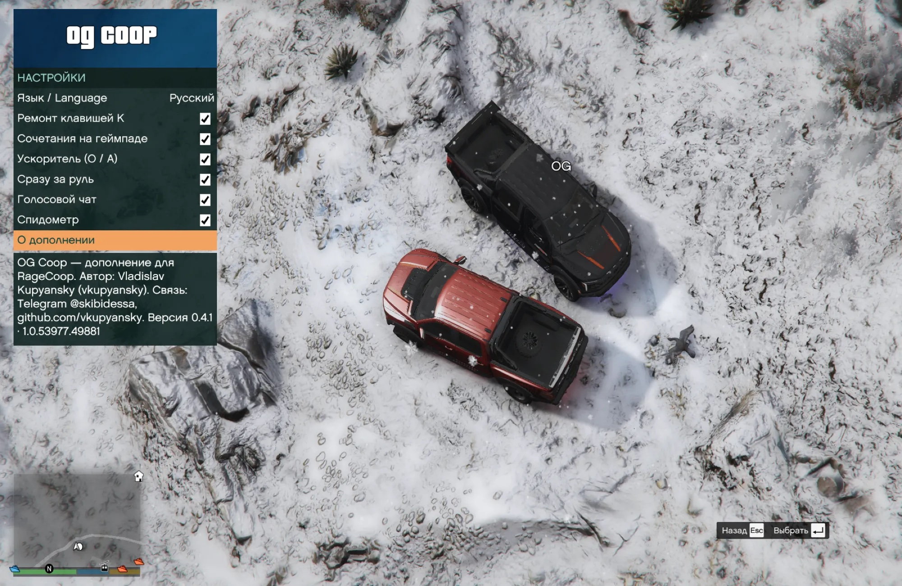

# OG Coop

**🇬🇧 English** · [🇷🇺 Русский](README.ru.md)

GTA Online interiors, your own character, yacht and home, and a handy menu for playing GTA V Legacy with friends on [RageCoop](https://ragecoop.com/).

[](https://github.com/vkupyansky/og-coop/releases/latest)


[](LICENSE)

**[Download](https://github.com/vkupyansky/og-coop/releases/latest)** · [Install](#install) · [Host a server](#host-a-server) · [Controls](#controls) · [Report a problem](https://github.com/vkupyansky/og-coop/issues/new/choose)


OG Coop is an unofficial add-on for RageCoop. One installer sets up the game, the server sends the menu to everyone who joins, and RageCoop's own files stay untouched. The menu speaks English or Russian and works with a keyboard or a gamepad. Work in progress by Vladislav Kupyansky ([GitHub](https://github.com/vkupyansky), Telegram [@skibidessa](https://t.me/skibidessa)).

<h3 align="center">Online play you can pause</h3>
<p align="center">Press Esc and only your game stops, like in single player: you freeze in place and vanish for your friends. Unpause and carry on from the same spot, even in mid-flight.</p>

## Features

- **GTA Online interiors.** 82 interiors behind 158 street doors, each with its Online map icon: the Diamond Casino and its penthouse, apartments, houses and mansions, CEO offices, biker clubhouses, bunkers, nightclubs, the LS Car Meet and its test track, the Kortz Center halls, El Rubio's mansion on Cayo Perico and many more. Walk into the orange circle at a door to go in. The way out is a circle where you appear, however you got inside.
- **People inside**, as in GTA Online: guards, cashiers, bartenders, dancers and guests in the same spots, doing the same things. And a beach party on Cayo Perico.
- **Your character.** A creator like the one in GTA Online: heritage, face, hair, make-up, every Online outfit and tattoo. It opens the first time you join, is kept on the server under your name, and friends see you exactly as you made yourself.
- **Your yacht.** A Galaxy Super Yacht at one of 35 berths along the coast, with your choice of model, colour, railings, lights and flag. Its captain moves it to another berth.
- **Your home.** Pick a penthouse, apartment, house or mansion: you appear there when you join, and Go home brings you back from anywhere.
- **Vehicles.** Spawn any GTA vehicle and get straight behind the wheel, keep favourites and a garage of up to 64 tuned cars on the server, tune at Los Santos Customs and everyone sees the result. Repair, flip, and hold O for a boost. Installed add-on cars spawn by their model name.
- **Drive through traffic.** A shared switch that lets cars, bikes, quads and bicycles pass through NPC traffic.
- **Special places.** Cayo Perico, North Yankton, the aircraft carriers, yachts and a cargo ship, with map icons.
- **Shared world.** One waypoint, weather and time of day for everyone, and snow on the ground with tyre and foot tracks.
- **Clean free roam.** No mission markers, random events, side jobs or phone calls in the way.
- **Playing together.** Teleport to a friend or straight into a free seat in their car, hold N for voice chat, respawn next to your partner instead of at a hospital.
- **GTA Online radio stations and weapon attachments**, Mk II included.
- **Fixes for RageCoop.** Hangs, races, repeating rockets and wreck explosions, drifting name tags, a stuck microphone and more, fixed while the game runs. The full list is in [engine changes](ENGINE_CHANGES.md).

## Screenshots

<p align="center">
  
  
</p>
<p align="center"><sub>Transport · Teleports</sub></p>

<p align="center">
  
  
</p>
<p align="center"><sub>Partners · Character</sub></p>

<p align="center">
  
  
</p>
<p align="center"><sub>Character creator · Weapons</sub></p>

<p align="center">
  
</p>
<p align="center"><sub>Settings. The menu speaks English or Russian</sub></p>

## Install

You need **GTA V Legacy 1.0.3889** on Windows. Enhanced is not supported. RageCoop is included in the download.

1. Start Story Mode once and close GTA. Turn off BattlEye for Story Mode in the Rockstar Games Launcher, or use the official `-nobattleye` launch option on Steam or Epic ([Rockstar's guide](https://support.rockstargames.com/articles/1nenwhZlVrJY6CTFeSS2Fx/grand-theft-auto-online-battleye-faq)).
2. Download `OGCoop-Addon.zip`, extract it (right-click, Extract All) and run **Install.exe**. If Windows says "Windows protected your PC", click More info, then Run anyway.
3. The installer finds the game, checks its version, puts everything next to `GTA5.exe` and checks Visual C++ and .NET Framework 4.8. If it cannot find the game, drag `GTA5.exe` into its window. When it asks for ScriptHookV, click Download on [its author's page](https://www.dev-c.com/gtav/scripthookv/) and leave the ZIP in Downloads.
4. Start GTA, open Story Mode, press **F9** and enter the host's address. Press **J** for the menu.

**Updating:** download the new `OGCoop-Addon.zip` and run its **Install.exe**. It replaces only what changed and keeps your settings. Then start GTA again.

On VK Play, do all of this inside the cloud PC, on its persistent game drive. If the installer cannot run there, copy everything from the `client` folder next to `GTA5.exe`, together with `ScriptHookV.dll` and `dinput8.dll` from ScriptHookV. When updating from Coop Control this way, delete `scripts\CoopControl.EarlyClient.dll` if it is there.

## Host a server

1. Extract `OGCoop-Addon.zip` and put its `server` folder anywhere you can write to. GTA is not needed on that PC.
2. Windows: double-click **Start server**, .NET is included. Linux or macOS: run `sh start-server.sh` with the x64 [.NET 10 Runtime](https://dotnet.microsoft.com/en-us/download/dotnet/10.0) installed. On a Mac with Apple silicon take the macOS x64 installer: it needs Rosetta, and the script finds it on its own.
3. The first start creates `Settings.xml` and listens on UDP **4499**. The window shows the addresses to give friends, see [connecting players](#connecting-players). The server is not listed publicly. Play with people you trust: everyone connected can use the shared tools.
4. To stop it, use **Stop server**, `sh stop-server.sh` or Ctrl+C in its window. Garages, characters, yachts and homes are saved on every change.

**Updating the server:** stop it and copy the new `server` folder over the old one. `Settings.xml` and player data stay. Use the RageCoop **1.5.12.15** files from this release: another nightly with the same number is not necessarily compatible.

### Connecting players

| Where the friend plays | What the host does | Address the friend enters |
| --- | --- | --- |
| On the server PC | Nothing | `127.0.0.1:4499` |
| On the same home network | Nothing | The server PC's local address, e.g. `192.168.1.20:4499` |
| Elsewhere, the host has a public IP | Forwards UDP 4499 on the router | The host's public address, e.g. `203.0.113.5:4499` |
| Elsewhere, no public IP | Sets up a virtual network or a tunnel | The address that app shows |

<details>
<summary>Public IP, port forwarding, virtual networks and tunnels</summary>

**Does the host have a public IP?** Compare the "Internet" or "WAN" address on the router's status page with the one any "what is my IP" site shows. If they match, the IP is public. If the router shows `100.64.x.x` to `100.127.x.x`, `10.x.x.x` or `192.168.x.x`, the provider shares one address between customers (CGNAT) and port forwarding will not work.

**Port forwarding.** In the router settings, forward UDP 4499 to the server PC's local address, port 4499. Give that PC a fixed local address (DHCP reservation) and allow UDP 4499 in its firewall. A VPN that sends all of the host's traffic through itself can block incoming players: exclude the server or turn the VPN off.

**Virtual network.** Everyone installs the same app and joins one network, then the friend enters the server's address in that network with `:4499`. [Tailscale](https://tailscale.com/) and [ZeroTier](https://www.zerotier.com/) work on Windows, macOS and Linux. [Radmin VPN](https://www.radmin-vpn.com/) is free and popular, but Windows only.

**Tunnel.** A service such as [playit.gg](https://playit.gg/) runs a small agent on the server PC and gives a public address for local UDP port 4499, so friends install nothing. Handy when a friend plays on a cloud PC. Free plans change over time, and the extra hop can add a little delay.

</details>

## Controls

| Action | Keyboard | Xbox |
| --- | --- | --- |
| OG Coop menu | J | Hold LB + RB, press Down |
| Repair | K | Hold LB + RB, press Up |
| Select / back | Enter / Esc | A / B |
| Navigate | Arrow keys | D-pad |
| Boost | Hold O | Hold A while driving (duck still works) |
| Voice chat | Hold N | |
| GTA pause and map | Esc | Menu / Start |

Language: Settings > Language. Each player picks their own. Esc pauses only your own game: while you are in the pause menu, your character disappears for others and the traffic your game controls stands still.

## Stay up to date

The installer and the server tell you when a newer version is out: the host sees it in the server window, and every player who joins gets one chat line. `OG_COOP_UPDATE_CHECK=0` turns the server check off. To get an e-mail on every release, click **Watch > Custom > Releases** on GitHub. When updating, the host updates the server first, then each player runs the new Install.exe.

## Report a problem

[Open an issue](https://github.com/vkupyansky/og-coop/issues/new/choose) and choose **Problem / Ошибка**. Say what you did and what happened, and attach the logs: `install-log.txt` next to Install.exe, `scripts/RageCoop/Data/RageCoop.Client.log` in the GTA folder, or the text from the server window. Questions and ideas: Telegram [@skibidessa](https://t.me/skibidessa).

## Good to know

- Interiors are places to visit together. GTA Online activities inside them (casino games, business production, buying property) are not included.
- Your look changes only in the creator, J > Character > Appearance. Clothes shops, barbers, tattoo parlours and the safehouse wardrobe are closed on the server, and switching between Michael, Franklin and Trevor is off.
- The yacht comes without a helicopter, jet skis or yacht services.
- The radio station is shared, the exact song position and personal music are not.
- Parked cars, boats and planes are shared, one copy each. Shop clerks and other NPCs at fixed spots are separate for each player. See also the [known issues](ENGINE_CHANGES.md#known-issues).

## Optional extras

**ReShade.** [ReShade](https://reshade.me) makes the picture a little brighter and sharper, on your screen only. Skip it on a weak PC. Run its setup, choose `GTA5.exe` and DirectX 10/11/12, and when it asks for a preset, pick `OGCoop.ini` from the `reshade` folder of the download. Home opens the ReShade menu in game. In multiplayer ReShade turns off depth-based effects itself, so the preset uses only colour and sharpness.

**Add-on cars.** Each player installs add-on car models separately, and everyone needs the same files. Spawn one by its model name: Transport > Enter spawn code. The models and their authors' permissions are not covered by this project's MIT licence.

<details>
<summary>Build from source</summary>

Unzip both the source and the add-on ZIPs. Install the .NET SDK pinned in `work/RageCoopAdmin/global.json` (**10.0.403**). In that folder, copy `References.example.props` to `References.props` and point `RageCoopClientDir` to the add-on's `client/scripts/RageCoop`, `RageCoopServerDir` to `server`, and `LemonUiDll` to `lib/net48/LemonUI.SHVDN3.dll` from [LemonUI.SHVDN3 2.2.0](https://www.nuget.org/packages/LemonUI.SHVDN3/2.2.0). Then, from `work/RageCoopAdmin`:

```sh
dotnet restore Client/RageCoopAdmin.Client.csproj --locked-mode -p:PublicRelease=true -warnaserror
dotnet build Client/RageCoopAdmin.Client.csproj -c Release --no-restore -p:PublicRelease=true -warnaserror
```

Build Server, Bootstrap, EarlyClient and Installer the same way. The release archives are packed from the maintainer's working copy: `tools/prepare_public_release.py` does not run from this source archive. Its pinned SHVDN 3.7.0-nightly.188 and .NET Runtime 10.0.14 (win-x64) downloads and their digests are listed there. From the source root, `bash tools/check.sh --public-release` runs the public builds and checks (Windows with Git Bash, or macOS with CrossOver and .NET Framework 4.8).

</details>

## License

Our code is [MIT](LICENSE), © 2026 Vladislav Kupyansky (vkupyansky). RageCoop and the other components keep their own licences and credits, listed in [THIRD_PARTY.txt](THIRD_PARTY.txt). ScriptHookV and ReShade are downloaded from their authors separately.
