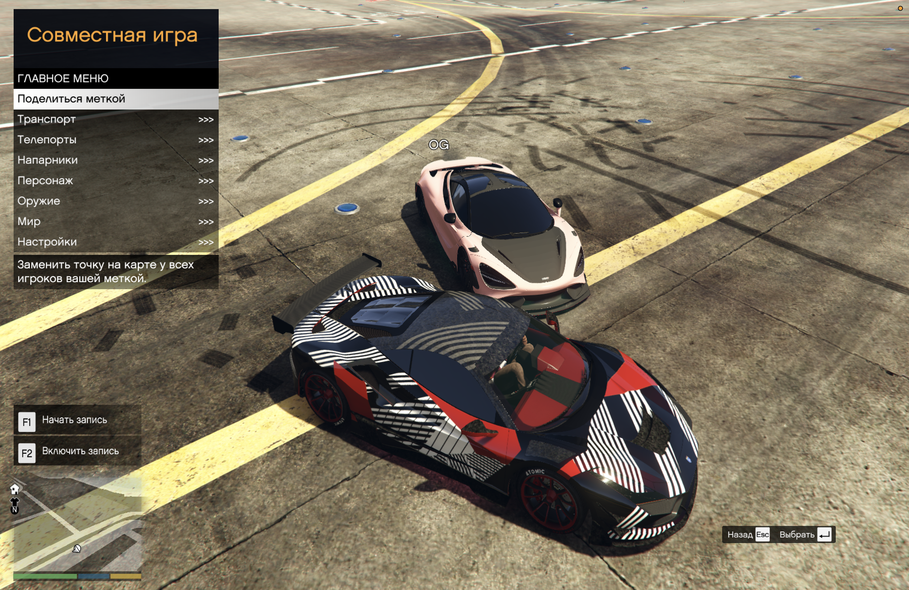
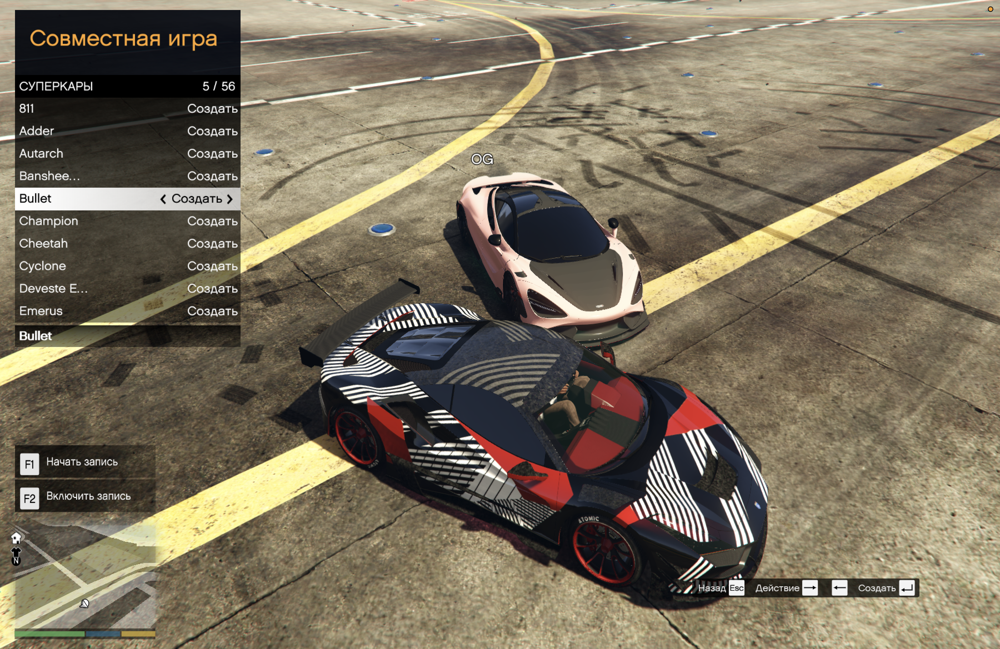

# Coop Control

## 🇷🇺 Русский · [🇬🇧 Read in English →](README.md)

**Удобное меню, интерьеры GTA Online и исправления стабильности для совместной игры в GTA V Legacy через RageCoop.**

Автор — **Vladislav Kupyansky (vkupyansky)** · [GitHub](https://github.com/vkupyansky) · Telegram [@skibidessa](https://t.me/skibidessa)

В разработке · MIT · Меню на русском или английском

**[Скачать v0.3.0-wip](https://github.com/vkupyansky/coop-control/releases/latest)** · [Все выпуски](https://github.com/vkupyansky/coop-control/releases) · [Сообщить о проблеме](https://github.com/vkupyansky/coop-control/issues/new/choose)

Сам мультиплеер — это [RageCoop](https://ragecoop.com/). Coop Control — неофициальное дополнение к нему: меню с машинами, гаражом, телепортами, интерьерами GTA Online и общими настройками мира, один установщик, который всё ставит сам, и исправления ряда проблем поддерживаемой сборки RageCoop. Файлы самого RageCoop не изменяются.

### Что добавляет Coop Control

- **Машины:** поиск и создание любых машин GTA, избранное, гараж для машин с тюнингом (до 64). Гараж и избранное хранятся на сервере по нику RageCoop и одинаковы на любом компьютере.
- **Тюнинг:** обычный Los Santos Customs; другие игроки видят машину ровно такой, какой вы её сделали.
- **Вождение:** ремонт с места водителя и пассажира, переворот на колёса, ускоритель по удержанию клавиши.
- **Проезд сквозь трафик:** общий переключатель — машины, мотоциклы, квадроциклы и велосипеды проезжают сквозь машины NPC. На мотоцикле проходят и водитель, и пассажир. Игроки, созданные машины, пешеходы и окружение остаются твёрдыми. Сервер помнит переключатель после перезапуска.
- **Интерьеры GTA Online:** 61 интерьер за настоящими дверями с улицы — казино Diamond и пентхаус, квартиры и дома, офисы CEO с гаражами, клубы байкеров и их бизнесы, бункер, ангар, база, ночной клуб, аркада, автомастерская, LS Car Meet, Record A Studios, Music Locker, склады, агентства, особняки и другие. У каждого значок как в Online; зайдите в жёлтый круг у двери — и вы внутри.
- **Особые места:** Кайо-Перико (появляется при подлёте), Северный Янктон, авианосцы, яхты, грузовое судно и другие — со значками на карте.
- **Общий мир:** одна метка, погода и время суток на всех; фиксация времени и погоды; в снежную погоду снег на земле и следы колёс и шагов.
- **Спокойная свободная игра:** нет меток заданий, случайных событий, подработок и звонков, которые мешают играть вместе. Магазины и Los Santos Customs работают как обычно.
- **Телепорты:** к метке на карте и к другу, в том числе сразу на свободное пассажирское место.
- **Голосовой чат:** удерживайте N — вас слышат все на сервере. После смерти вы появляетесь рядом с напарником, а не в больнице.
- **Радио и оружие Online:** станции GTA Online на колесе радио; обвесы и окраска оружия, включая Mk II.
- **Персонаж:** оружие, патроны, здоровье, броня и способности.
- **Управление:** клавиатура и геймпад; русский и английский текст в поиске и названиях гаража.
- **Язык:** Настройки → Язык / Language → Русский / English, у каждого игрока свой.

### Что мы изменили в RageCoop

Изменения применяются во время игры проверенными перехватами: если сборка RageCoop отличается от поддерживаемой, перехват просто не ставится. Коротко:

- **Исправлено:** зависания при создании машин, сбой уборки снарядов, гонки в списке игроков, загрузке ресурсов и запросах к серверу, чтение пакетов с выделением памяти до проверки размера, отремонтированная машина со старыми повреждениями, повторные взрывы обломков на каждом обновлении, ник, уезжающий вбок на экранах не 16:9, журнал клиента, останавливающийся после отключения, выстрелы самолётов, которых не видели другие игроки, микрофон, остававшийся включённым после отпускания кнопки рации.
- **Добавлено:** машины и лодки, которые обе игры ставят на одно место, становятся одной общей копией; трафик, убранный игрой одного игрока, подхватывает игра другого, а не замирает; машины и водители в 150 м видны всегда.
- **Убрано:** настройка списка серверов, принимавшая любой сертификат; поиск, который заменял машины в 2 м при создании новой.

Полный список — в [изменениях основы](ENGINE_CHANGES.ru.md).

### Скриншоты

Настоящие кадры совместной игры вдвоём, меню на русском.


<details>
<summary>Меню, каталог машин, гараж и напарники</summary>

**Транспорт, телепорты и общие настройки**



**Каталог машин GTA**



**Сохранённые машины, цвета и тюнинг**


**Перемещение к напарнику**


</details>

### Установка — игроку

Поддерживается **GTA V Legacy 1.0.3889** на Windows (Enhanced не поддерживается). Совместимые клиент и сервер RageCoop уже входят в архив.

**Ставлю впервые**

1. Один раз запустите сюжетный режим и закройте GTA. Отключите BattlEye для сюжетного режима в Rockstar Games Launcher; в Steam и Epic — официальный параметр запуска `-nobattleye` ([инструкция Rockstar](https://support.rockstargames.com/articles/1nenwhZlVrJY6CTFeSS2Fx/grand-theft-auto-online-battleye-faq)).
2. Скачайте `CoopControl-Addon.zip`, распакуйте его (правой кнопкой → «Извлечь всё») и запустите **Install.exe**. Если Windows пишет «Система Windows защитила ваш компьютер» — «Подробнее» → «Выполнить в любом случае».
3. Установщик сам находит GTA V Legacy, проверяет версию, ставит всё нужное рядом с `GTA5.exe`, проверяет Visual C++ и .NET Framework 4.8 и пишет, что делать дальше. Если игру не нашёл — перетащите в его окно файл `GTA5.exe`.
4. ScriptHookV нельзя класть в архив: когда установщик попросит, нажмите Download на [странице автора](https://www.dev-c.com/gtav/scripthookv/) и оставьте ZIP в «Загрузках» — установщик сам возьмёт из него файлы.
5. Запустите GTA → сюжетный режим → **F9** → адрес сервера друга. Меню открывается на **J**.

**Обновляю** — скачайте новый `CoopControl-Addon.zip`, распакуйте его и снова запустите **Install.exe**. Он заменит только изменившееся; гараж, избранное и настройки меню останутся. Затем запустите GTA заново.

В VK Play делайте всё внутри облачного компьютера, на его постоянном игровом диске. Если установщик не запускается, скопируйте вручную всё из папки `client` рядом с `GTA5.exe`, а также `ScriptHookV.dll` и `dinput8.dll` из ScriptHookV.

Само меню скачивается с сервера при подключении.

### Установка — владельцу сервера

1. Распакуйте `CoopControl-Addon.zip` и положите папку `server` туда, где разрешена запись. GTA на сервере не нужна.
2. Windows: двойной щелчок по **Start server** (.NET уже внутри). Linux или macOS: `sh start-server.sh` с установленным x64 [.NET 10 Runtime](https://dotnet.microsoft.com/en-us/download/dotnet/10.0).
3. В окне сервера появятся адреса для друзей — см. [«Как подключаются игроки»](#как-подключаются-игроки). Первый запуск создаст `Settings.xml` и запустит сервер на UDP **4499**. В публичном списке его нет; играйте с теми, кому доверяете: общие инструменты доступны всем подключённым.
4. Остановить: **Stop server** (Windows) или `sh stop-server.sh`, либо Ctrl+C в окне сервера. Гараж и избранное сохраняются при каждом изменении.

**Обновление сервера:** остановите его, замените файлы, оставив `Settings.xml` и данные игроков. В `Resources/Server/CoopAdmin` должна быть только `CoopAdmin.dll`. Используйте файлы RageCoop **1.5.12.15** из этого выпуска: другая nightly с тем же номером не обязательно совместима.

### Обновления

Новые версии приносят новые места, исправления и возможности, а новое меню игроки получают только после того, как владелец обновит сервер. Поэтому:

- Установщик сам говорит, если вышла версия новее, и предлагает открыть её страницу.
- Сервер при запуске проверяет, нет ли версии новее: владелец видит это в окне сервера, а каждый вошедший игрок получает одну строку в чате. Отключить проверку — переменная окружения `COOP_CONTROL_UPDATE_CHECK=0`.
- На GitHub нажмите **Watch → Custom → Releases** — придёт письмо, когда выйдет новая версия.

Как обновиться: сначала владелец обновляет сервер (см. выше), затем каждый игрок запускает новый **Install.exe**.

### Сообщить о проблеме

[Создайте сообщение об ошибке](https://github.com/vkupyansky/coop-control/issues/new/choose) и выберите **Problem / Ошибка**. Опишите, что делали и что случилось, и приложите журналы: `install-log.txt` рядом с Install.exe, `scripts/RageCoop/Data/RageCoop.Client.log` в папке GTA или текст из окна сервера. Вопросы и идеи — Telegram [@skibidessa](https://t.me/skibidessa).

### Как подключаются игроки

Найдите строку, которая подходит другу. Сервер работает на **UDP 4499**.

| Где друг | Что делает владелец сервера | Какой адрес вводит друг |
| --- | --- | --- |
| На том же компьютере, что и сервер | Ничего | `127.0.0.1:4499` |
| В той же домашней сети | Ничего | Локальный адрес компьютера с сервером, например `192.168.1.20:4499` |
| В другом месте, у владельца внешний («белый») адрес | Открывает порт UDP 4499 на роутере | Внешний адрес владельца, например `203.0.113.5:4499` |
| В другом месте, внешнего адреса нет | Виртуальная сеть или туннель (ниже) | Адрес, который покажет программа |

**Есть ли внешний адрес?** Откройте страницу состояния роутера и сравните его адрес «Интернет / WAN» с тем, что показывает любой сайт «мой IP». Совпадают — адрес внешний. Если у роутера `100.64.x.x`–`100.127.x.x`, `10.x.x.x` или `192.168.x.x`, провайдер даёт один адрес на многих («серый», CGNAT), и открыть порт не получится.

**Открыть порт (внешний адрес есть).** В настройках роутера добавьте правило: UDP 4499 → локальный адрес компьютера с сервером, порт 4499. Закрепите за этим компьютером постоянный локальный адрес (резервирование в DHCP) и разрешите UDP 4499 в брандмауэре. Если на компьютере с сервером включён VPN, который пропускает через себя весь трафик, игроки могут не достучаться: добавьте сервер в исключения или выключите VPN.

**Виртуальная сеть (внешнего адреса нет).** Все ставят одну программу и входят в одну сеть; друг подключается к адресу сервера в этой сети с `:4499`.

- [Tailscale](https://tailscale.com/) — Windows, macOS, Linux; бесплатного тарифа хватает на небольшую компанию.
- [ZeroTier](https://www.zerotier.com/) — Windows, macOS, Linux.
- [Radmin VPN](https://www.radmin-vpn.com/) — бесплатный и популярный, но только для Windows.

**Туннель (внешнего адреса нет, друзьям ничего ставить не нужно).** Сервис вроде [playit.gg](https://playit.gg/) ставит маленькую программу на компьютер с сервером и выдаёт внешний адрес для локального порта UDP 4499. Друзья просто вводят этот адрес. Удобно, если друг играет с облачного компьютера, куда нельзя ставить программы; условия бесплатного тарифа меняются, а лишний узел может добавить немного задержки.

Что выбрать: есть внешний адрес — открыть порт (быстрее всего). Нет — виртуальная сеть; если друзья ничего не могут установить — туннель.

### Управление

| Действие | Клавиатура | Xbox |
| --- | --- | --- |
| Меню Coop Control | J | Удерживать LB + RB, нажать ↓ |
| Ремонт | K | Удерживать LB + RB, нажать ↑ |
| Выбрать / назад | Enter / Esc | A / B |
| Навигация | Стрелки | Крестовина |
| Ускоритель | Удерживать O | Удерживать A за рулём (приседание работает) |
| Голосовой чат | Удерживать N | — |
| Пауза и карта GTA | Esc | Menu / Start |

Пока вы вводите текст, буквы и клавиши редактирования принадлежат полю. Настройки меню хранятся на компьютере, гараж и избранное — на сервере. Esc ставит на паузу только вашу игру: пока вы в меню паузы, ваш персонаж и трафик вашей игры у других стоят.

### По желанию: ReShade

[ReShade](https://reshade.me) делает картинку чуть ярче и чётче. Он меняет только ваш экран и не обязателен — на слабом компьютере его можно не ставить. Запустите его установщик → выберите `GTA5.exe` → DirectX 10/11/12 → когда спросит про пресет, выберите `CoopControl.ini` из папки `reshade` архива. В игре клавиша Home открывает меню ReShade, там же эффекты можно выключить. В сетевой игре ReShade сам отключает эффекты глубины, поэтому в пресете только цвет и резкость.

### Ограничения

- Радиостанция и её выключение общие; место в песне и личная музыка — нет.
- Машины, лодки и самолёты на стоянках, которые обе игры ставят в одно место, общие — по одному экземпляру; продавцы и NPC на постоянных местах у каждого свои. См. также [известные проблемы](ENGINE_CHANGES.ru.md#известные-проблемы).
- Интерьеры — места, куда можно зайти вместе; занятия GTA Online внутри них (игры казино, производство бизнесов, покупка недвижимости) не входят.

### Дополнительные машины

Модели дополнительных машин необязательны и ставятся каждым игроком отдельно. У всех должны быть одинаковые файлы и подходящий каталог меню. Скачивание моделей и разрешения их авторов не входят в MIT-лицензию нашего проекта.

### Сборка из исходников (для разработчиков)

Распакуйте архивы исходников и дополнения. Установите .NET SDK из `work/RageCoopAdmin/global.json` (**10.0.402**). В этой папке скопируйте `References.example.props` в `References.props` и укажите: `RageCoopClientDir` — папка `client/scripts/RageCoop` дополнения, `RageCoopServerDir` — `server`, `LemonUiDll` — `lib/net48/LemonUI.SHVDN3.dll` из [LemonUI.SHVDN3 2.2.0](https://www.nuget.org/packages/LemonUI.SHVDN3/2.2.0). Затем из `work/RageCoopAdmin`:

```sh
dotnet restore Client/RageCoopAdmin.Client.csproj --locked-mode -p:PublicRelease=true -warnaserror
dotnet build Client/RageCoopAdmin.Client.csproj -c Release --no-restore -p:PublicRelease=true -warnaserror
```

Server, Bootstrap, EarlyClient и Installer собираются так же. Для упаковки дополнения нужны официальные ZIP SHVDN 3.7.0-nightly.188 и .NET Runtime 10.0.13 (win-x64) в `outputs/public-deps`; их адреса и закреплённые хеши — в `tools/prepare_public_release.py`. Из корня исходников `bash tools/check.sh --public-release` запускает публичные сборки и проверки (Windows с Git Bash или macOS с CrossOver и .NET Framework 4.8).

### Лицензия

Наш код — [MIT](LICENSE), © 2026 Vladislav Kupyansky (vkupyansky). RageCoop и остальные компоненты сохраняют свои лицензии и авторство, они перечислены в [THIRD_PARTY.txt](THIRD_PARTY.txt). ScriptHookV и ReShade скачиваются у их авторов отдельно.
