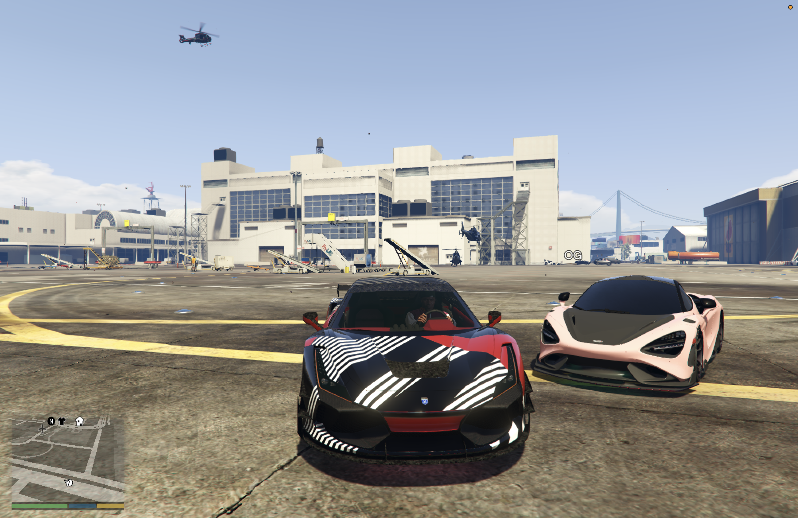
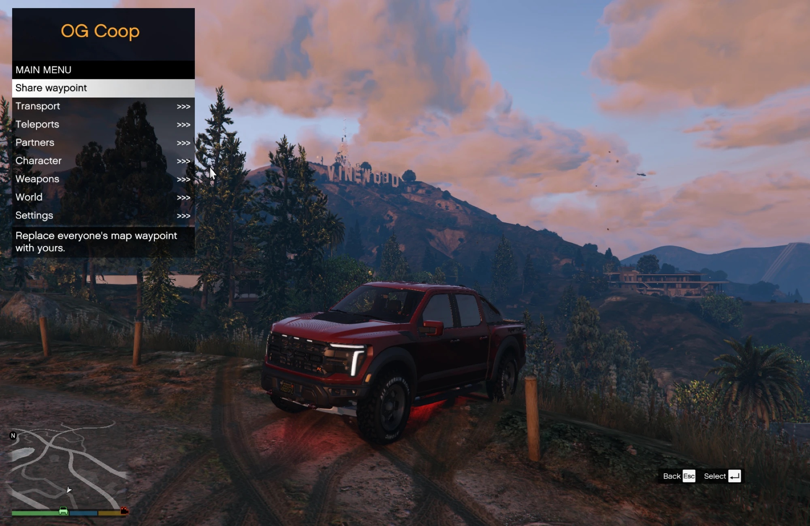
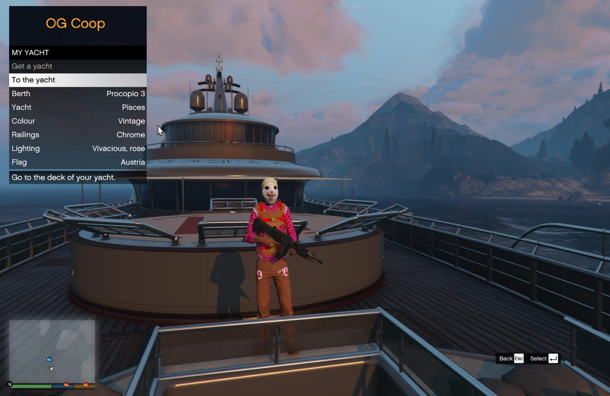
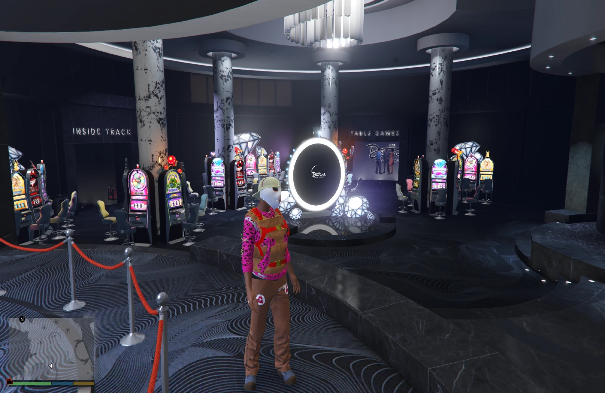
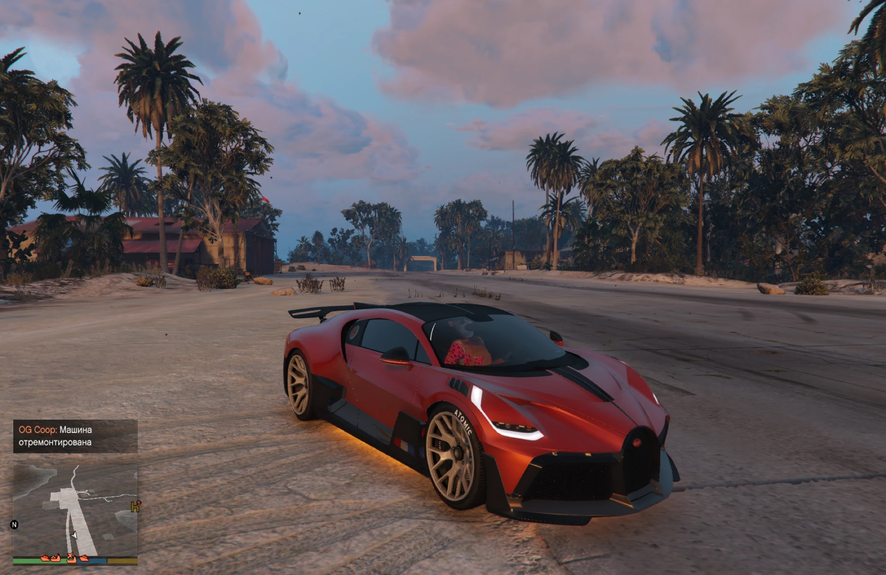
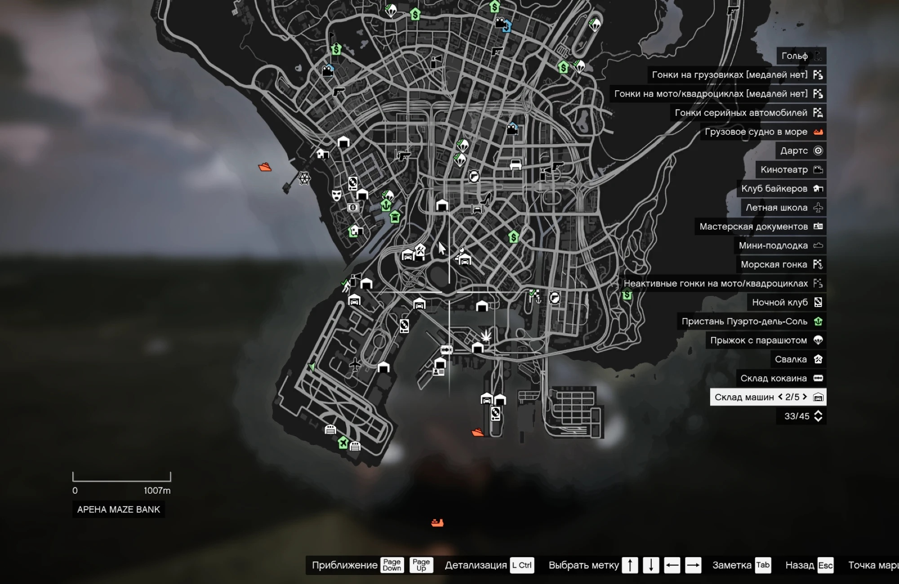
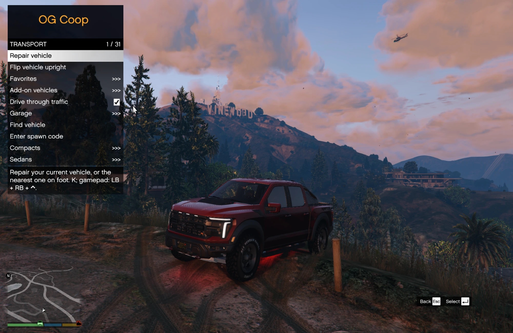
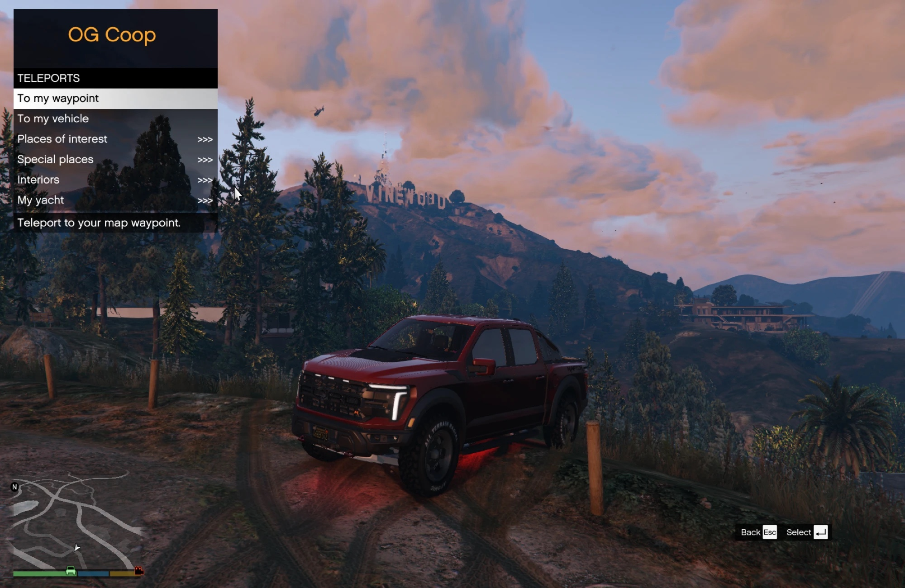

# OG Coop

[🇬🇧 English](README.md) · **🇷🇺 Русский**

Интерьеры GTA Online, свой персонаж, яхта и жильё и удобное меню для игры в GTA V Legacy с друзьями через [RageCoop](https://ragecoop.com/).

[](https://github.com/vkupyansky/og-coop/releases/latest)


[](LICENSE)

**[Скачать](https://github.com/vkupyansky/og-coop/releases/latest)** · [Установка](#установка) · [Свой сервер](#свой-сервер) · [Управление](#управление) · [Сообщить о проблеме](https://github.com/vkupyansky/og-coop/issues/new/choose)



OG Coop это неофициальное дополнение к RageCoop. Один установщик ставит всё нужное в игру, сервер сам раздаёт меню каждому, кто подключился, а файлы RageCoop не меняются. Меню на русском или английском, с клавиатуры или геймпада. Проект в разработке, автор Vladislav Kupyansky ([GitHub](https://github.com/vkupyansky), Telegram [@skibidessa](https://t.me/skibidessa)).

## Возможности

- **Интерьеры GTA Online.** 82 интерьера за 158 дверями с улицы, у каждой двери значок, как в Online: казино Diamond и пентхаус, апартаменты, дома и особняки, офисы CEO, клубы байкеров, бункеры, ночные клубы, LS Car Meet с тестовой трассой, залы Kortz Center, особняк Эль Рубио на Кайо-Перико и многое другое. Зайдите в жёлтый круг у двери, и вы внутри. Выход всегда там, где вы появились, как бы вы ни попали внутрь.
- **Люди внутри**, как в GTA Online: охрана, кассиры, бармены, танцующие и гости на тех же местах и с тем же делом. А на пляже Кайо-Перико вечеринка.
- **Свой персонаж.** Редактор как в GTA Online: наследственность, лицо, волосы, макияж, вся одежда и татуировки Online. Открывается сам при первом входе, хранится на сервере по нику, и друзья видят вас таким же.
- **Своя яхта.** Galaxy Super Yacht на одной из 35 стоянок вдоль берега: модель, цвет, перила, подсветка и флаг на выбор. Капитан перегоняет её на другую стоянку.
- **Своё жильё.** Выберите пентхаус, апартаменты, дом или особняк: после входа на сервер вы появляетесь там, а кнопка "Домой" возвращает туда из любого места.
- **Машины.** Любая машина GTA, и вы сразу за рулём. Избранное и гараж до 64 машин с тюнингом хранятся на сервере, тюнинг в Los Santos Customs видят все. Ремонт, переворот, ускоритель на O. Установленные отдельно машины создаются по коду модели.
- **Проезд сквозь трафик.** Общий переключатель: машины, мотоциклы, квадроциклы и велосипеды проезжают сквозь трафик NPC.
- **Особые места.** Кайо-Перико, Северный Янктон, авианосцы, яхты и грузовое судно, со значками на карте.
- **Общий мир.** Одна метка, погода и время суток на всех, а в снег на земле остаются следы колёс и шагов.
- **Спокойная свободная игра.** Нет меток заданий, случайных событий, подработок и звонков.
- **Вместе с друзьями.** Перенестись к другу или сразу на свободное место в его машине, голосовой чат на N, после смерти появиться рядом с напарником, а не в больнице.
- **Радиостанции GTA Online и обвесы оружия**, в том числе Mk II.
- **Исправления RageCoop.** Зависания, гонки потоков, повторные ракеты и взрывы обломков, уезжающие ники, залипающий микрофон и другое, прямо во время игры. Полный список в [изменениях основы](ENGINE_CHANGES.ru.md).

## Скриншоты

<p align="center">
  
  
</p>
<p align="center"><sub>Меню на J · Своя яхта и её настройки</sub></p>

<p align="center">
  
  
</p>
<p align="center"><sub>Казино Diamond · Кайо-Перико</sub></p>

<p align="center">
  
</p>
<p align="center"><sub>Входы на карте паузы. GTA показывает только часть значков сразу, так что входов намного больше, чем видно здесь</sub></p>

<details>
<summary>Ещё разделы меню</summary>

<p align="center">
  
  
</p>
<p align="center">
  
  
</p>

</details>

## Установка

Нужна **GTA V Legacy 1.0.3889** на Windows, Enhanced не поддерживается. RageCoop уже есть в архиве.

1. Один раз запустите сюжетный режим и закройте GTA. Отключите BattlEye для сюжетного режима в Rockstar Games Launcher, а в Steam и Epic добавьте официальный параметр запуска `-nobattleye` ([инструкция Rockstar](https://support.rockstargames.com/articles/1nenwhZlVrJY6CTFeSS2Fx/grand-theft-auto-online-battleye-faq)).
2. Скачайте `OGCoop-Addon.zip`, распакуйте его (правой кнопкой, "Извлечь всё") и запустите **Install.exe**. Если Windows пишет "Система Windows защитила ваш компьютер", нажмите "Подробнее", затем "Выполнить в любом случае".
3. Установщик сам находит игру, проверяет версию, ставит всё рядом с `GTA5.exe` и проверяет Visual C++ и .NET Framework 4.8. Если игру не нашёл, перетащите в его окно файл `GTA5.exe`. Когда попросит ScriptHookV, нажмите Download на [странице автора](https://www.dev-c.com/gtav/scripthookv/) и оставьте ZIP в папке "Загрузки".
4. Запустите GTA, сюжетный режим, нажмите **F9** и введите адрес сервера друга. Меню открывается на **J**.

**Обновление:** скачайте новый `OGCoop-Addon.zip` и запустите его **Install.exe**. Он заменит только изменившееся и сохранит ваши настройки. Затем запустите GTA заново.

В VK Play делайте всё внутри облачного компьютера, на его постоянном игровом диске. Если установщик там не запускается, скопируйте всё из папки `client` рядом с `GTA5.exe`, а также `ScriptHookV.dll` и `dinput8.dll` из ScriptHookV.

## Свой сервер

1. Распакуйте `OGCoop-Addon.zip` и положите папку `server` туда, где разрешена запись. GTA на этом компьютере не нужна.
2. Windows: двойной щелчок по **Start server**, .NET уже внутри. Linux или macOS: `sh start-server.sh` с установленным x64 [.NET 10 Runtime](https://dotnet.microsoft.com/en-us/download/dotnet/10.0).
3. Первый запуск создаст `Settings.xml` и откроет сервер на UDP **4499**. В окне сервера появятся адреса для друзей, см. [как подключаются игроки](#как-подключаются-игроки). В публичном списке серверов его нет. Играйте с теми, кому доверяете: общие инструменты доступны всем подключённым.
4. Остановить: **Stop server**, `sh stop-server.sh` или Ctrl+C в окне сервера. Гаражи, персонажи, яхты и жильё сохраняются при каждом изменении.

**Обновление сервера:** остановите его и скопируйте новую папку `server` поверх старой. `Settings.xml` и данные игроков останутся. Используйте файлы RageCoop **1.5.12.15** из этого выпуска: другая nightly с тем же номером не обязательно совместима.

### Как подключаются игроки

| Где играет друг | Что делает владелец сервера | Какой адрес вводит друг |
| --- | --- | --- |
| На компьютере с сервером | Ничего | `127.0.0.1:4499` |
| В той же домашней сети | Ничего | Локальный адрес компьютера с сервером, например `192.168.1.20:4499` |
| В другом месте, у владельца внешний (белый) адрес | Открывает порт UDP 4499 на роутере | Внешний адрес владельца, например `203.0.113.5:4499` |
| В другом месте, внешнего адреса нет | Ставит виртуальную сеть или туннель | Адрес, который покажет программа |

<details>
<summary>Внешний адрес, открытие порта, виртуальные сети и туннели</summary>

**Есть ли внешний адрес?** Сравните адрес "Интернет" или "WAN" на странице состояния роутера с тем, что показывает любой сайт "мой IP". Совпадают, значит адрес внешний. Если у роутера адрес от `100.64.x.x` до `100.127.x.x`, `10.x.x.x` или `192.168.x.x`, провайдер даёт один адрес многим (серый адрес, CGNAT), и открыть порт не получится.

**Открыть порт.** В настройках роутера добавьте правило: UDP 4499 на локальный адрес компьютера с сервером, порт 4499. Закрепите за этим компьютером постоянный локальный адрес (резервирование в DHCP) и разрешите UDP 4499 в брандмауэре. VPN, который пропускает через себя весь трафик владельца, может не пускать игроков: добавьте сервер в исключения или выключите VPN.

**Виртуальная сеть.** Все ставят одну программу и входят в одну сеть, а друг вводит адрес сервера в этой сети с `:4499`. [Tailscale](https://tailscale.com/) и [ZeroTier](https://www.zerotier.com/) работают на Windows, macOS и Linux. [Radmin VPN](https://www.radmin-vpn.com/) бесплатный и популярный, но только для Windows.

**Туннель.** Сервис вроде [playit.gg](https://playit.gg/) ставит маленькую программу на компьютер с сервером и выдаёт внешний адрес для локального порта UDP 4499, и друзьям ничего ставить не нужно. Удобно, если друг играет с облачного компьютера. Условия бесплатных тарифов меняются, а лишний узел может добавить немного задержки.

</details>

## Управление

| Действие | Клавиатура | Xbox |
| --- | --- | --- |
| Меню OG Coop | J | Удерживать LB + RB, нажать вниз |
| Ремонт | K | Удерживать LB + RB, нажать вверх |
| Выбрать / назад | Enter / Esc | A / B |
| Навигация | Стрелки | Крестовина |
| Ускоритель | Удерживать O | Удерживать A за рулём (приседание работает) |
| Голосовой чат | Удерживать N | |
| Пауза и карта GTA | Esc | Menu / Start |

Язык: Настройки > "Язык / Language", у каждого игрока свой. Esc ставит на паузу только вашу игру: пока вы в меню паузы, ваш персонаж и трафик вашей игры у других стоят.

## Обновления

Установщик и сервер сами говорят, если вышла версия новее: владелец видит это в окне сервера, а каждый вошедший игрок получает строку в чате. Отключить проверку на сервере: `OG_COOP_UPDATE_CHECK=0`. Чтобы получать письмо о каждом выпуске, нажмите на GitHub **Watch > Custom > Releases**. Обновляться так: сначала владелец обновляет сервер, затем каждый игрок запускает новый Install.exe.

## Сообщить о проблеме

[Создайте сообщение об ошибке](https://github.com/vkupyansky/og-coop/issues/new/choose) и выберите **Problem / Ошибка**. Напишите, что делали и что случилось, и приложите журналы: `install-log.txt` рядом с Install.exe, `scripts/RageCoop/Data/RageCoop.Client.log` в папке GTA или текст из окна сервера. Вопросы и идеи: Telegram [@skibidessa](https://t.me/skibidessa).

## Полезно знать

- В интерьеры можно заходить вместе, но занятий GTA Online внутри (игры казино, производство бизнесов, покупка недвижимости) нет.
- Внешность меняется только в редакторе: J > Персонаж > Внешность. Магазины одежды, парикмахерские, салоны татуировок и гардероб в убежище на сервере закрыты, а сменить Майкла, Франклина или Тревора нельзя.
- У яхты нет вертолёта, гидроциклов и услуг яхты.
- Радиостанция общая, а место в песне и личная музыка у каждого свои.
- Машины, лодки и самолёты на стоянках общие, по одному экземпляру. Продавцы и NPC на постоянных местах у каждого игрока свои. См. также [известные проблемы](ENGINE_CHANGES.ru.md#известные-проблемы).

## По желанию

**ReShade.** [ReShade](https://reshade.me) делает картинку чуть ярче и чётче, только на вашем экране. На слабом компьютере его можно не ставить. Запустите его установщик, выберите `GTA5.exe` и DirectX 10/11/12, а когда спросит про пресет, выберите `OGCoop.ini` из папки `reshade` архива. В игре меню ReShade открывается на Home. В сетевой игре ReShade сам отключает эффекты глубины, поэтому в пресете только цвет и резкость.

**Дополнительные машины.** Модели машин каждый игрок ставит отдельно, и у всех должны быть одинаковые файлы. Создать такую машину можно по коду модели: Транспорт > "Ввести код модели". Сами модели и разрешения их авторов не входят в MIT-лицензию проекта.

<details>
<summary>Сборка из исходников</summary>

Распакуйте архивы исходников и дополнения. Установите .NET SDK из `work/RageCoopAdmin/global.json` (**10.0.402**). В этой папке скопируйте `References.example.props` в `References.props` и укажите в `RageCoopClientDir` папку `client/scripts/RageCoop` дополнения, в `RageCoopServerDir` папку `server`, в `LemonUiDll` файл `lib/net48/LemonUI.SHVDN3.dll` из [LemonUI.SHVDN3 2.2.0](https://www.nuget.org/packages/LemonUI.SHVDN3/2.2.0). Затем из `work/RageCoopAdmin`:

```sh
dotnet restore Client/RageCoopAdmin.Client.csproj --locked-mode -p:PublicRelease=true -warnaserror
dotnet build Client/RageCoopAdmin.Client.csproj -c Release --no-restore -p:PublicRelease=true -warnaserror
```

Server, Bootstrap, EarlyClient и Installer собираются так же. Для упаковки дополнения нужны официальные ZIP SHVDN 3.7.0-nightly.188 и .NET Runtime 10.0.13 (win-x64) в `outputs/public-deps`, их адреса и закреплённые хеши указаны в `tools/prepare_public_release.py`. Из корня исходников `bash tools/check.sh --public-release` запускает публичные сборки и проверки (Windows с Git Bash или macOS с CrossOver и .NET Framework 4.8).

</details>

## Лицензия

Наш код под [MIT](LICENSE), © 2026 Vladislav Kupyansky (vkupyansky). RageCoop и остальные компоненты сохраняют свои лицензии и авторство, они перечислены в [THIRD_PARTY.txt](THIRD_PARTY.txt). ScriptHookV и ReShade скачиваются у их авторов отдельно.
